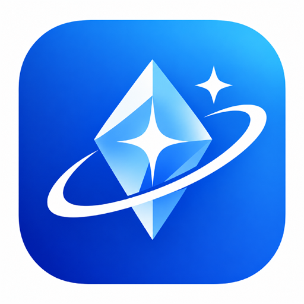

<div align="center">
  
  <h1>Tasmate</h1>
  <p><strong>タスク管理を、「クエスト」に変えよう。</strong></p>
  <p>現実の勉強・作業を、キャラクターの成長と拠点づくりにつなげる生活支援ゲーム。</p>
  <p>
    <a href="#日本語">日本語</a> ・ <a href="#english">English</a>
  </p>
  <p>
    
    <a href="https://github.com/Tasmate-app/Tasmate/actions/workflows/ci.yml">
      
    </a>
  </p>
</div>

---

## 日本語

### Tasmateとは

Tasmate は、現実のタスク・勉強・作業時間をゲームの進行に結びつける生活支援型の育成ゲームです。取り組んだ時間に応じて通貨・素材・経験値を獲得し、キャラクターの育成や施設の強化、3Dシェアハウスの拠点づくりを進められます。

タスク管理とタイマーの使いやすさを土台に、現実で頑張ることがゲーム内の成長につながる体験を目指しています。Web版とAndroid版（Expo / React Native）でゲームロジックを共有しています。

### 主な特徴

- **クエストとしてタスクを管理** — タスク名・カテゴリ・予定時間を登録し、タイマーで作業を記録。中断・再開や作業履歴の確認にも対応します。
- **作業が報酬になる** — 実作業時間に応じて通貨・経験値・星屑・結晶・キャラクター専用素材を獲得します。
- **タスク内容をキーワードで評価** — カテゴリのユーザーキーワードと組み込みキーワードから、結晶タイプと難易度を判定します。外部AIは使用しません。
- **キャラクターと拠点を育てる** — 素材でキャラクターを強化し、施設を稼働・強化。3Dシェアハウスで拠点の様子を眺められます。
- **週間計画と継続を支援** — 週間カレンダー、繰り返し予定、80%の週間達成判定、連続達成に応じた報酬倍率、休息週を扱います。
- **Web / Android 対応** — 共通のゲームロジックをWebとNativeで共有します。

### はじめかた

#### Web版

必要環境は Node.js 20以上（推奨22）と npm 10以上です。

```powershell
npm install
npm run dev
```

開発サーバーは http://localhost:5173 で起動します。

本番ビルドを確認する場合:

```powershell
npm run build
npm run preview
```

> WindowsのPowerShellで `npm.ps1` の実行が制限される場合は、`npm.cmd` を使用してください。

#### Android版

[GitHub Releases](https://github.com/Tasmate-app/Tasmate/releases) からAPKをダウンロードできます。

Expoで起動する場合:

```powershell
npm run start -w tasmate-mobile
```

APKのローカルビルド手順は、末尾の「開発・運用の詳細」にある「Android APK のローカルビルド」を参照してください。

### 技術スタック

| 領域 | 使用技術 |
| --- | --- |
| Web | React 19 / TypeScript / Vite / React Router / Zustand |
| 3D | Three.js / React Three Fiber |
| Native | Expo / React Native / Expo Router / AsyncStorage / expo-gl |
| 共通 | npm workspaces / `@tasmate/core` / `@tasmate/types` / `@tasmate/design-tokens` / `@tasmate/task-evaluation` |
| テスト | Vitest / Playwright |

### リポジトリ構成

```
src/                       Web版
apps/mobile/               Expo React Native版
packages/core/             Web/Native共通のゲームロジック・ストア・保存
packages/types/            共有型
packages/design-tokens/    共通デザイントークン
packages/task-evaluation/  キーワードによるタスク評価
tests/                     Vitest単体テスト / Playwright E2E
docs/                      仕様・設計ドキュメント
public/assets/             Web用アセット
```

### 開発

| コマンド | 内容 |
| --- | --- |
| `npm run dev` | 開発サーバーを起動 |
| `npm run build` | 型チェック + 本番ビルド |
| `npm run preview` | 本番ビルドのプレビュー |
| `npm run lint` | ESLint |
| `npm run typecheck` | TypeScript型チェック |
| `npm run test` | Vitest単体テスト |
| `npm run e2e:install` | Playwright Chromiumの初回導入 |
| `npm run e2e` | Playwright E2E |
| `npm run typecheck -w tasmate-mobile` | Native版の型チェック |

### データとプライバシー

- データは端末内に保存します。Webは `localStorage`（キー `tasmate:state:v1`）、Nativeは `AsyncStorage` を使用します。
- 設定画面からアプリ状態をJSONファイルとして書き出し・復元できます（最大5MB）。
- Nativeの予定クエスト通知は端末内で予約・表示し、外部サーバーへ送信しません。
- 現時点でアカウント登録・クラウド同期・外部AIへの送信はありません。
- 詳細は [プライバシーポリシー](docs/privacy-policy.md) を参照してください。

### ドキュメント

- [`docs/01_project_overview.md`](docs/01_project_overview.md)：目的、コンセプト、主な画面
- [`docs/02_game_design.md`](docs/02_game_design.md)：ゲームループ、タスク・報酬、育成、施設、拠点
- [`docs/03_feature_list.md`](docs/03_feature_list.md)：機能一覧、優先度、MVPの範囲
- [`docs/04_data_design.md`](docs/04_data_design.md)：データモデル、保存、タスク評価の入出力
- [`docs/05_roadmap_and_open_questions.md`](docs/05_roadmap_and_open_questions.md)：開発段階、未決定事項
- [`docs/06_weekly_calendar_and_streak.md`](docs/06_weekly_calendar_and_streak.md)：週間カレンダー、繰り返し、達成判定、継続報酬
- [`docs/07_react_native_plan.md`](docs/07_react_native_plan.md)：Native版・モノレポ化の計画
- [`docs/characters/voxel-character-standard.md`](docs/characters/voxel-character-standard.md)：ボクセルキャラクターの規格
- [`docs/characters/parts-and-naming.md`](docs/characters/parts-and-naming.md)：パーツ階層と命名規則

### ライセンス

本リポジトリで作成したソースコードは [MIT License](LICENSE) の下で公開しています。

Copyright (c) 2026 Tasmate-app contributors.

外部から取得したSkillや第三者提供の素材は、それぞれのライセンスに従います。詳細は「Skills とライセンス」を参照してください。

### 開発・運用の詳細

<details>
<summary>画面とルーティング</summary>

ゲーム一体型のUIです。上部HUD（ロゴ・通貨・素材・作業状態）とナビゲーションから各画面を操作します。768px未満ではHUDのメニューボタンから左ドロワーを開き、768px以上では常設の左サイドバーを表示します。表示項目と並び順は設定画面から変更でき、ホームは常に表示されます。

ブレークポイントは480 / 768 / 1024pxの3段階です。ページ本文は最大1200pxで中央寄せし、狭い画面では左右余白を12pxにします。

| パス | 画面 |
| --- | --- |
| `/` | ホーム：今週の進捗、次のクエスト、クエストボード、タイマー、探索進行、リザルト |
| `/history` | 履歴：作業時間の集計・推移・カテゴリー別内訳、セッション一覧 |
| `/plan` | 計画：週間カレンダー、繰り返し予定、週間達成、連続達成ランク、休息週 |
| `/base` | 拠点：3Dシェアハウス、キャラクターと施設の状況 |
| `/character` | キャラクター：一覧とステータス画面 |
| `/facilities` | 施設：生産・コスト・稼働切替・強化 |
| `/inventory` | かばん：所持アイテム・報酬履歴 |
| `/shop` | ショップ：施設強化の購入 |
| `/synthesis` | 合成：かけらと硬貨から結晶を作成 |
| `/settings` | 設定：通知、サイドバー、バックアップ、アプリ情報、ライセンス |
| `/categories` | 分類管理：履歴画面から開く |
| `/settings/licenses` | OSSライセンス一覧 |

旧URLは次の正規URLへリダイレクトします。

- `/sortie` → `/`
- `/calendar` → `/plan`
- `/companions` → `/character`
- `/storage` → `/inventory`
- `/house` → `/base`

</details>

<details>
<summary>CI/CD</summary>

`.github/workflows/ci.yml` はPull Request、mainへのpush、手動実行で次を確認します。

- `npm run lint`
- `npm run typecheck`
- `npm run test`
- `npm run build`
- `npm run typecheck -w tasmate-mobile`
- `npm run licenses:generate` 後の生成物差分
- Playwright E2E（Chromium）

mainのBranch protectionでは `CI / web` と `CI / e2e` を必須チェックにします。

`vX.Y.Z` 形式のタグをmain上のコミットに付けてpushすると、`.github/workflows/release.yml` が実行されます。

1. 次のversionを更新します。
   - ルート `package.json`
   - `apps/mobile/package.json`
   - `apps/mobile/app.json` の `expo.version`
   - `apps/mobile/app.json` の `expo.android.versionCode`（リリースごとに増加）
2. mainへマージし、CIの成功を確認します。
3. タグを作成してpushします。

```powershell
git tag v0.1.0
git push origin v0.1.0
```

Release workflowは次を行います。

- タグが `vX.Y.Z` 形式でmain上にあり、3つのversionがタグと一致することを検証
- WebをビルドしてCloudflare Pagesへ本番デプロイ
- Androidのrelease APKをローカルGradleでビルド（全4ABI）
- APKをGitHub Release（prerelease）へ `tasmate-vX.Y.Z.apk` として添付

失敗時はActionsの `Release` を `workflow_dispatch` で同じタグを指定して再実行できます。タグの付け替えは行いません。

</details>

<details>
<summary>Android APK のローカルビルド</summary>

ExpoのprebuildとローカルのAndroid SDK（Gradle）を使い、EASを介さずAPKを作成します。

#### 必要環境

- JDK 17（`JAVA_HOME` を設定）
- Android Studio / Android SDK
  - SDK Platform 37
  - Build-Tools 37.0.0
  - Platform-Tools
  - NDK 27.1.12297006
  - CMake 3.31.6（Windowsの長いパス対策）
- 環境変数 `ANDROID_HOME`（例: `%LOCALAPPDATA%\Android\Sdk`）

#### ビルド

```powershell
npm run apk:release -w tasmate-mobile
```

出力: `apps/mobile/android/app/build/outputs/apk/release/app-release.apk`

端末へ導入:

```powershell
adb install -r apps/mobile/android/app/build/outputs/apk/release/app-release.apk
```

- `apk:release` は `.env` の署名情報が必須です。未設定時はdebug署名へフォールバックせずエラーで停止します。
- `debug` APKはMetroの起動が必要なため、単体確認には `release` を使います。
- ネイティブ設定を変更した場合は `npm run prebuild:android -w tasmate-mobile -- --clean` で再生成します。
- `expo-notifications` のプラグイン設定（通知アイコン・チャンネル・`SCHEDULE_EXACT_ALARM`）を含むため、通知機能の確認にはAPK/開発ビルドを再作成します。Expo Goでは設定の一部が反映されません。
- `apps/mobile/android/` は生成物のためコミットしません。
- 初回はGradle・Android SDK・NDKのダウンロードで数GBと時間がかかります。

#### リリース署名でビルドする場合

リポジトリ直下の `.env`（Git管理対象外）に署名情報を設定します。`.env.example` をコピーして値を埋めます。

```dotenv
TASMATE_UPLOAD_STORE_FILE=C:/path/to/tasmate-release.keystore
TASMATE_UPLOAD_STORE_PASSWORD=...
TASMATE_UPLOAD_KEY_ALIAS=tasmate
TASMATE_UPLOAD_KEY_PASSWORD=...
```

`npm run apk:release -w tasmate-mobile` は `.env` と `.env.local` を読み込み、release署名でAPKをビルドします。シェルで設定した環境変数は `.env` より優先されます。4つの値が不足している場合やkeystoreが見つからない場合はエラーで停止します。署名なしのdebug APKは `npm run apk:debug -w tasmate-mobile` を使います。

`TASMATE_UPLOAD_STORE_FILE` は絶対パス、またはリポジトリ直下からの相対パスで指定します。Windowsのパスは `C:/...` のようにスラッシュ区切りにすると確実です。

署名設定は `apps/mobile/plugins/withAndroidReleaseSigning.js` がprebuild時に `android/app/build.gradle` へ反映します。`.env` はコミットしません。

</details>

<details>
<summary>Cloudflare Pages の準備</summary>

1. Cloudflare PagesでDirect Uploadのプロジェクトを作成します（例: `tasmate-web`）。production branchは `main` にします。
2. APIトークンを作成します（Account → Cloudflare Pages → Edit）。
3. GitHubのSettings → Secrets and variables → Actionsに登録します。

| 種別 | 名前 | 値 |
| --- | --- | --- |
| Secret | `CLOUDFLARE_API_TOKEN` | Pages:EditのAPIトークン |
| Variable | `CLOUDFLARE_ACCOUNT_ID` | CloudflareアカウントID |
| Variable | `CLOUDFLARE_PAGES_PROJECT` | Pagesプロジェクト名 |

SPAの直リンクは `public/_redirects`（`/* /index.html 200`）で `index.html` にフォールバックします。

#### Android署名の準備

リポジトリ外でkeystoreを作成し、Base64にしてSecretsへ登録します。keystoreとパスワードは失うと更新できなくなるため厳重にバックアップしてください。

```powershell
keytool -genkeypair -v -storetype PKCS12 -keystore "$env:USERPROFILE\tasmate-release.keystore" -alias tasmate -keyalg RSA -keysize 2048 -validity 10000
[Convert]::ToBase64String([IO.File]::ReadAllBytes("$env:USERPROFILE\tasmate-release.keystore")) | Set-Clipboard
```

| Secret | 内容 |
| --- | --- |
| `ANDROID_KEYSTORE_BASE64` | keystoreのBase64 |
| `ANDROID_KEYSTORE_PASSWORD` | keystoreのパスワード |
| `ANDROID_KEY_ALIAS` | キーエイリアス |
| `ANDROID_KEY_PASSWORD` | キーのパスワード |

CIはkeystoreを `$RUNNER_TEMP` に展開し、ビルド後に削除します。APKがdebug署名でないことを `apksigner` で検証します。

</details>

<details>
<summary>Skills とライセンス</summary>

`.agents/skills/` に配置しているSkillのライセンス一覧です。外部から取得したSkillは `skills-lock.json` で取得元を管理しています。

| Skill | 提供元 | ライセンス |
| --- | --- | --- |
| `eas-app-stores`<br>`eas-simulator`<br>`expo-design-system`<br>`expo-examples`<br>`expo-native-ui`<br>`expo-overview`<br>`expo-router`<br>`expo-upgrade` | [expo/skills](https://github.com/expo/skills) | MIT |
| `frontend-design` | 外部（[`LICENSE.txt`](.agents/skills/frontend-design/LICENSE.txt) 同梱） | Apache-2.0 |
| `data-security`<br>`game-domain`<br>`game-ui-design`<br>`task-timer`<br>`testing-quality`<br>`threejs-development` | 本リポジトリで作成 | MIT（[`LICENSE`](LICENSE)） |

Skillを再配布する場合は、各ライセンスの条件（著作権表示・ライセンス全文の保持など）に従ってください。

</details>

<details>
<summary>仮実装の一覧（仕様未確定のため固定しないこと）</summary>

- 報酬ルール・全数値（`packages/core/src/rewards/rewardConfig.ts`、`src/domain/constants.ts` の `BALANCE`）
- 属性は3種＋無属性、相性倍率1.5（`docs/02` §4は未決定）
- 同時進行セッションは1件まで
- キャラ初期所持2人、施設2種、素材3種（`src/data/seed.ts`）
- 通貨初期値100、中断時報酬係数0.5、下限60秒未満は報酬なし
- 結晶タイプのキーワード判定とカテゴリ初期キーワード（`packages/task-evaluation/src/keywordAnalyzer.ts`、`packages/core/src/categories.ts`）
- 仕様確定後は `docs/` とテストを合わせて更新すること

</details>

---

## English

### Overview

Tasmate is a life-support game that turns real study and work time into character growth, resource gathering, and base building. Complete tasks and focus sessions, earn currency and materials, then invest them in characters and facilities.


### Features

- **Quest-style task management** — Create tasks with categories and planned durations, track work with a timer, and pause or resume sessions.
- **Rewards for real effort** — Earn currency, experience, stardust, crystals, and character-specific materials based on actual work time.
- **Keyword-based task evaluation** — Crystal types and difficulty are determined from category keywords and built-in keywords. No external AI is used.
- **Character and base progression** — Strengthen characters, run and upgrade facilities, and view your 3D share house.
- **Weekly planning and streaks** — Weekly calendar, recurring plans, 80% completion goals, streak multipliers, and rest weeks.
- **Web and Android** — Shared game logic across the Web and Native apps.

### Quick Start

Requirements: Node.js 20+ (22 recommended) and npm 10+.

```powershell
npm install
npm run dev
```

Open http://localhost:5173.

Android APKs are available from [GitHub Releases](https://github.com/Tasmate-app/Tasmate/releases). To start the Expo app:

```powershell
npm run start -w tasmate-mobile
```

### Tech Stack

React 19 / TypeScript / Vite / React Router / Zustand / Three.js / React Three Fiber / Expo / React Native / Expo Router / AsyncStorage / Vitest / Playwright.

### Documentation

- [Project overview](docs/01_project_overview.md)
- [Game design](docs/02_game_design.md)
- [Feature list](docs/03_feature_list.md)
- [Data design](docs/04_data_design.md)
- [Roadmap and open questions](docs/05_roadmap_and_open_questions.md)
- [Weekly calendar and streaks](docs/06_weekly_calendar_and_streak.md)
- [React Native plan](docs/07_react_native_plan.md)
- [Privacy policy](docs/privacy-policy.md)

### License

Source code created in this repository is released under the [MIT License](LICENSE).

Copyright (c) 2026 Tasmate-app contributors.

Third-party skills and assets follow their respective licenses.
